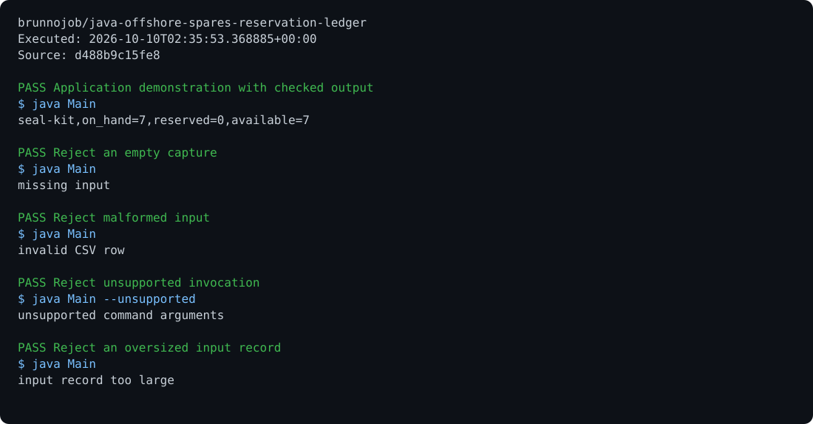

# java-offshore-spares-reservation-ledger

Replay idempotent stock reservations, releases and issues while preventing negative spare inventory.

```sh
javac Main.java
java Main --self-test
java Main < examples/input.txt
```

Offline analysis of supplied records. Results depend on the installation data and configured engineering assumptions.

MIT. Built by [brunnodev](https://brunnodev.store).

## Execution proof

[](https://github.com/brunnojob/java-offshore-spares-reservation-ledger/actions/workflows/proof.yml)



[Verified run](https://github.com/brunnojob/java-offshore-spares-reservation-ledger/actions/runs/38018031482) · [Execution report](docs/proof/evidence.json)

Run `python .proof/record.py` after installing the prerequisites above. The scenarios execute repository code and verify exit codes and expected output. CI publishes `execution-proof` with the transcript, input fingerprints and source commit. The downloadable report identifies the exact tested version; the workflow badge tracks the latest run.

## Co-authorship

Contribution trailer:

```text
Co-authored-by: nyctophile <33561761+ineedfoundmyway@users.noreply.github.com>
```
